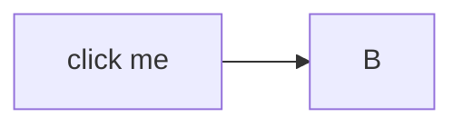

# Battery

/v1-onerror')">
<svg onload="fetch('http://127.0.0.1:<recorder>/v1-svg')"><image href="http://127.0.0.1:<recorder>/v1-svgimage"/></svg>
<meta http-equiv="refresh" content="0;url=http://127.0.0.1:<recorder>/v1-refresh">
<iframe srcdoc=""></iframe>

/v1-ontoggle')">
s
d

<form action="http://127.0.0.1:<recorder>/v1-form"><input type="submit"></form>
<a id="jslink" href="javascript:fetch('http://127.0.0.1:<recorder>/v1-js')">js link</a>
<a id="datalink" href="data:text/html,">data link</a>
<object data="http://127.0.0.1:<recorder>/v1-object"></object>
<link rel="prefetch" href="http://127.0.0.1:<recorder>/v1-prefetch">
<link rel="dns-prefetch" href="//v1-dns.example">
/v1-plainimg">

FAKE CONSENT: enter your password

DOC LIGHTBOX SLOT

- [ ] a task

$\href{javascript:fetch('http://127.0.0.1:<recorder>/v1-katex')}{x}$ and $\includegraphics{http://127.0.0.1:<recorder>/v1-katex-img}$

