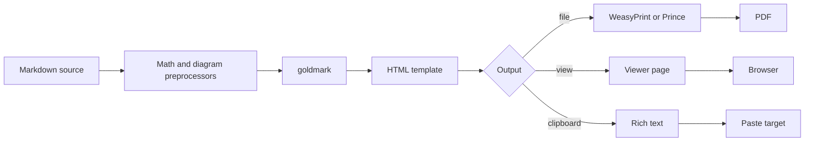
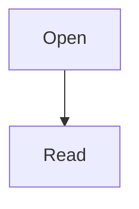
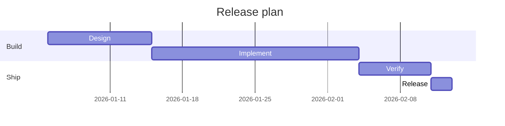
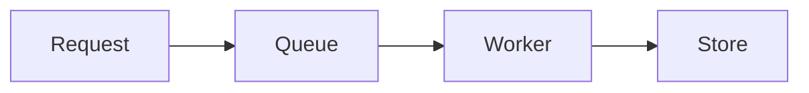

# SVG fit

How the viewer sizes SVG. Resize the window, or the contents panel, to see each one follow the room it has.

An SVG is drawn at its natural width, or wider until its small print reaches 12px or its typical text reaches 16px, whichever comes first. It is never wider than the panel less its gutters. One wider than this column of text is centred on the column.

## A wide drawing

Natural width 1400px, labels 14px. It leaves the column and takes the room there is, up to its natural size.

## A drawing with small print

Natural width 360px, labels 8px. It grows by half, to 540px, where its labels reach 12px.

## A drawing already at reading size

Natural width 360px, labels 16px. It stays as it is.

## A drawing with no text

Nothing to judge a size by, so it stays natural.

## A wide diagram

## A small diagram

## A diagram with small text

## A diagram its author sized

A `vellum:scale 0.5` hint keeps it to half the column.

<!-- vellum:scale 0.5 -->

## Left alone

An image inside a sentence, like this one , keeps its natural size.
