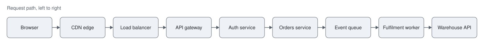
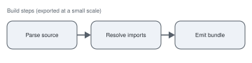
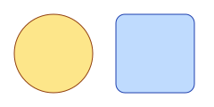
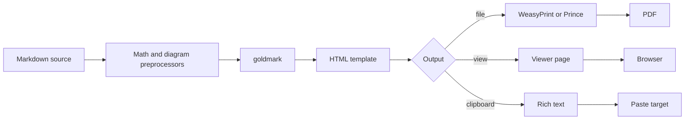
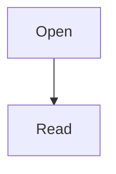
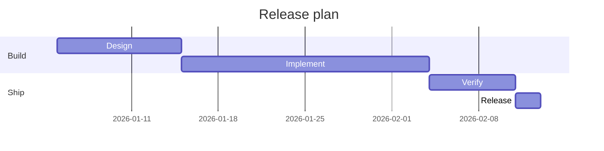
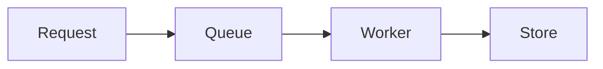

# SVG fit

How the viewer sizes SVG. Resize the window, or the contents panel, to see each one follow the room it has.

An SVG is drawn at its natural width, or wider until its small print reaches 12px or its typical text reaches 16px, whichever comes first. It is never wider than the panel less its gutters. One wider than this column of text is centred on the column.

## A wide drawing

Natural width 1400px, labels 14px. It leaves the column and takes the room there is, up to its natural size.

## A drawing with small print

Natural width 360px, labels 8px. It grows by half, to 540px, where its labels reach 12px.

## A drawing already at reading size

Natural width 360px, labels 16px. It stays as it is.

## A drawing with no text

Nothing to judge a size by, so it stays natural.

## A wide diagram

## A small diagram

## A diagram with small text

## A diagram its author sized

A `vellum:scale 0.5` hint keeps it to half the column.

<!-- vellum:scale 0.5 -->

## A drawing written into the document

The small-print drawing again, as `<svg>` markup in the Markdown. It grows the same way.

<svg xmlns="http://www.w3.org/2000/svg" width="360" height="90" viewBox="0 0 360 90" role="img" aria-label="Build steps">
<text x="10" y="18" font-family="Helvetica, Arial, sans-serif" font-size="8" fill="#57606a">Build steps (exported at a small scale)</text><rect x="10" y="30" width="100" height="40" rx="8" fill="#eef2f7" stroke="#57606a"/><text x="60.0" y="52.8" text-anchor="middle" font-family="Helvetica, Arial, sans-serif" font-size="8" fill="#24292f">Parse source</text><path d="M110 50 H122" stroke="#57606a" stroke-width="1.5" fill="none"/><path d="M130 50 l-9 -5 v10 z" fill="#57606a"/><rect x="130" y="30" width="100" height="40" rx="8" fill="#eef2f7" stroke="#57606a"/><text x="180.0" y="52.8" text-anchor="middle" font-family="Helvetica, Arial, sans-serif" font-size="8" fill="#24292f">Resolve imports</text><path d="M230 50 H242" stroke="#57606a" stroke-width="1.5" fill="none"/><path d="M250 50 l-9 -5 v10 z" fill="#57606a"/><rect x="250" y="30" width="100" height="40" rx="8" fill="#eef2f7" stroke="#57606a"/><text x="300.0" y="52.8" text-anchor="middle" font-family="Helvetica, Arial, sans-serif" font-size="8" fill="#24292f">Emit bundle</text></svg>

## A linked image

Wrapped in a link to itself, it grows too.

## A figure with a caption

<figure>

<figcaption>The caption stays under the drawing, across the column.</figcaption>
</figure>

## A drawing held to its container

The small-print drawing again, with `style="max-width: 100%; height: auto"`, as many exporters write it. That style only keeps it inside its container, so it grows past the column as if it had no style.

<svg xmlns="http://www.w3.org/2000/svg" width="360" height="90" viewBox="0 0 360 90" role="img" aria-label="Build steps" style="max-width: 100%; height: auto">
<text x="10" y="18" font-family="Helvetica, Arial, sans-serif" font-size="8" fill="#57606a">Build steps (exported at a small scale)</text><rect x="10" y="30" width="100" height="40" rx="8" fill="#eef2f7" stroke="#57606a"/><text x="60.0" y="52.8" text-anchor="middle" font-family="Helvetica, Arial, sans-serif" font-size="8" fill="#24292f">Parse source</text><path d="M110 50 H122" stroke="#57606a" stroke-width="1.5" fill="none"/><path d="M130 50 l-9 -5 v10 z" fill="#57606a"/><rect x="130" y="30" width="100" height="40" rx="8" fill="#eef2f7" stroke="#57606a"/><text x="180.0" y="52.8" text-anchor="middle" font-family="Helvetica, Arial, sans-serif" font-size="8" fill="#24292f">Resolve imports</text><path d="M230 50 H242" stroke="#57606a" stroke-width="1.5" fill="none"/><path d="M250 50 l-9 -5 v10 z" fill="#57606a"/><rect x="250" y="30" width="100" height="40" rx="8" fill="#eef2f7" stroke="#57606a"/><text x="300.0" y="52.8" text-anchor="middle" font-family="Helvetica, Arial, sans-serif" font-size="8" fill="#24292f">Emit bundle</text></svg>

## Left alone

An image inside a sentence, like this one , keeps its natural size.
