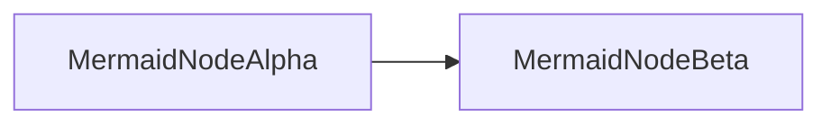

# Verify Release Fixture

Plain paragraph with **bold** and *italic* text.

## Second Heading

| Column A | Column B |
|----------|----------|
| tableCellOmega | 42 |

```go
func codeSentinel42() int { return 42 }
```



Inline math $e^{i\pi} + 1 = 0$ and display math:

$$
\int_0^1 x^2 \, dx = \frac{1}{3}
$$
